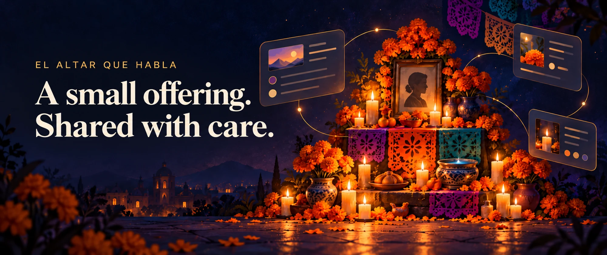

# El Altar que Habla · Día de los Muertos Ofrenda



An interactive, accessible, bilingual (English default / Spanish optional) Día de los Muertos ofrenda inspired by Mexican traditions, celebrating remembrance, memory, and cultural reverence.

- **Live Production URL:** [https://el-altar-que-habla.vercel.app](https://el-altar-que-habla.vercel.app)
- **GitHub Repository:** [https://github.com/earlgreyhot1701D/el-altar-que-habla](https://github.com/earlgreyhot1701D/el-altar-que-habla)
- **Status:** Release v1.0.0 (MVP Complete)

---

## ✦ Core Features & Cultural Meaning

Explore seven primary ofrenda elements through a cinematic altar and curated explanations:

1. **Cempasúchil (Marigolds):** The guiding flower whose scent and radiant color guide returning souls.
2. **Retratos (Portraits):** Dedications honoring ancestors and loved ones.
3. **Veladoras (Candles):** Lights of welcome, warmth, and guidance.
4. **Pan de Muerto (Bread of the Dead):** Sacred food shared in community and seasonal celebration.
5. **Papel Picado (Cut Paper):** Vibrant folk art representing movement, wind, and the fragile joy of life.
6. **Copal (Incense):** Aromatic resin burned for purification, welcoming, and sensory memory.
7. **Agua (Water):** Pure nourishment and hospitality for souls after their long journey.

Each offering features:
- **Curated Cultural Tabs:** *Context*, *History*, and *Variations* (acknowledging regional differences across Oaxaca, Puebla, Michoacán, and diverse families).
- **Custom Vector Artwork:** 7 handcrafted SVG illustrations representing each sacred item.
- **Bilingual Interface:** Seamless toggling between English (default) and Spanish across all titles, descriptions, tab copy, ARIA labels, and placeholders.
- **Accessible Dual Navigation:** Both spatial 2D altar hotspots and an accessible non-spatial list of offerings for keyboard-only and screen-reader users.
- **Deterministic Q&A:** Explicitly labeled curated guide fallback answering questions without fabricating information or masquerading as AI.

---

## ✦ Primary Cultural Sources

All descriptions draw directly from Mexican cultural institutions and UNESCO documentation:
- **INPI (Instituto Nacional de los Pueblos Indígenas):** [Significado de los elementos de una ofrenda](https://www.gob.mx/inpi/articulos/conoces-el-significado-de-los-elementos-de-una-ofrenda-de-dia-de-muertos?_amp=true)
- **INAH (Instituto Nacional de Antropología e Historia):** [Ofrendas para los muertos](https://www.inah.gob.mx/foto-del-dia/ofrendas-para-los-muertos)
- **UNESCO Intangible Cultural Heritage:** [Indigenous Festivity Dedicated to the Dead](https://ich.unesco.org/en/RL/dia-de-muertos-the-indigenous-festivity-dedicated-to-the-dead-00054)
- **Gobierno del Estado de México:** [Día de Muertos: altares y niveles](https://edomex.gob.mx/dia-de-muertos)

---

## ✦ Ethics & AI Concept Art Disclosure

- **Scene Artwork:** The atmospheric altar background is AI-generated concept artwork created to evoke reverence, rather than a documentary photograph of an actual private family altar.
- **No Hallucinations:** All cultural texts and facts are strictly deterministic and curated.
- **No Client Secrets:** No third-party API keys or personal identifiers exist in client code.

---

## ✦ Local Development & Testing

```bash
# Install dependencies
npm install

# Start local development server
npm run dev

# Run automated tests
npm test

# Build for production
npm run build
```

---

## ✦ Release Checklist (v1.0.0)

- [x] Unaltered V4 preserved in `baseline/v4.html`
- [x] Clean modular architecture (`src/content.js`, `src/sources.js`, `src/illustrations.js`, `src/styles.css`, `src/main.js`)
- [x] Seven offerings fully functional with bilingual text
- [x] Non-spatial navigation added for keyboard and screen-reader accessibility
- [x] Primary sources mapped to each element with direct HTTPS institutional links
- [x] Verified zero horizontal overflow on mobile (320px, 390px), tablet (768px), and desktop (1440px)
- [x] Automated test suite passing (`tests/smoke.test.js`)
- [x] Public live deployment on Vercel at `https://el-altar-que-habla.vercel.app`
- [x] MIT License and clean `.gitignore`

---

## ✦ v1.1.0 Enhancements: Life, Light & Gemma

- **Gemma 4 Inference (`gemma-4-26b-a4b-it`):** Genuine AI assistant grounded strictly on institutional texts with per-IP rate limiting and deterministic fallback.
- **Priority 3 Cultural Trust:** Offering-specific verified institutional links directly inside the detail panel. Claim-by-claim provenance against INAH and UNESCO passages. Explicit notice regarding regional server timeouts on the Edomex tiers reference without substituting unrelated links.
- **Priority 4 Visitor Experience:** Bilingual, skippable, accessible first-visit welcome modal; visited-offering tracking with subtle gold checkmarks; progress bar and completion acknowledgment.
- **Progressive Image Delivery:** CSS `image-set()` eliminates duplicate asset downloads on mobile, cutting altar image transfer by 38% (WebP 195 KB vs JPEG 312 KB) and improving mobile LCP.
- **Technical Architecture Note on Serverless Rate Limiting:**
  > [!NOTE]
  > The rate limiter in `/api/explain.js` uses an in-memory sliding window (15 requests/minute per IP). In serverless execution environments (such as Vercel), instances scale dynamically across distinct cold lambdas. Consequently, in-memory rate limiting operates on a *best-effort basis per instance* rather than globally across all edge locations. For high-traffic enterprise production, an edge key-value store (such as Upstash Redis or Vercel KV) would provide unified rate limiting.

---

## ✦ License

This project is licensed under the [MIT License](LICENSE).

