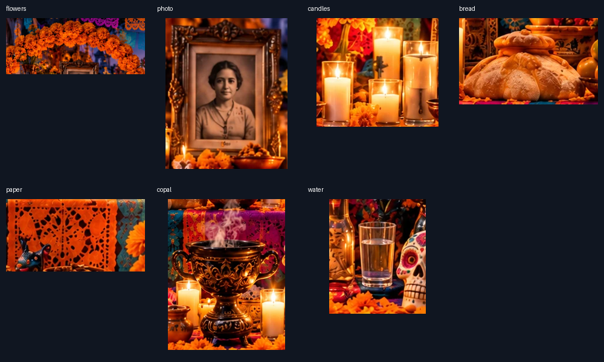

# Corrective QA evidence

Baseline: `cf8600244327aa4c09e141378d0cf3e15a772b39`.

The before/after captures select water in the actual local application, with
reduced motion enabled. They are full-page screenshots; the offering contact
sheet additionally shows all seven replacement crops at once.

| Viewport | Before | After |
| --- | --- | --- |
| 1400 × 900 | [Desktop](before-desktop.webp) | [Desktop](after-desktop.webp) |
| 768 × 1024 | [Tablet](before-tablet.webp) | [Tablet](after-tablet.webp) |
| 390 × 844 | [Mobile](before-mobile.webp) | [Mobile](after-mobile.webp) |



## Reproduce

```sh
npm ci
npm test
npm run build
npx playwright install chromium
npm run test:e2e
```

The added CI job runs these checks on Windows with Node 22. The initial browser
baselines were captured and visually reviewed on Windows/Chromium; screenshot
baselines are platform-specific. Review artwork changes by eye before explicitly
updating snapshots. DOM assertions alone cannot establish bitmap fidelity.

## Coverage and limits

- Unit/endpoint suite: 32 passing checks, including strict own-property IDs,
  contained prompt-building errors, bread context and background-only attribution.
- Browser suite: 11 checks covering actual hotspots, independently annotated
  object regions at all three sizes, non-overlap, image containment, keyboard
  destinations, English/Spanish, modal focus, stale responses and curated fallback.
- Mobile and tablet activate the real buttons with touch-emulated taps. These
  checks do not replace physical-device or full screen-reader testing.
- All seven crops and all three rendered layouts were visually inspected.
- Application assets loaded without HTTP errors; interaction checks captured no
  browser console/page errors or horizontal overflow.
- Provider responses are mocked for deterministic local tests; no model key was
  copied into this checkout. A live Gemma request against the changed server is
  not established by these tests. No hallucination-free guarantee is made.
- Cultural explanation objects and the server knowledge base are unchanged.
- The artwork remains AI-generated concept art. The original and edit details
  are preserved in [assets/README.md](../../assets/README.md).

No unrelated features, framework migration, production deployment or release tag
are included.
