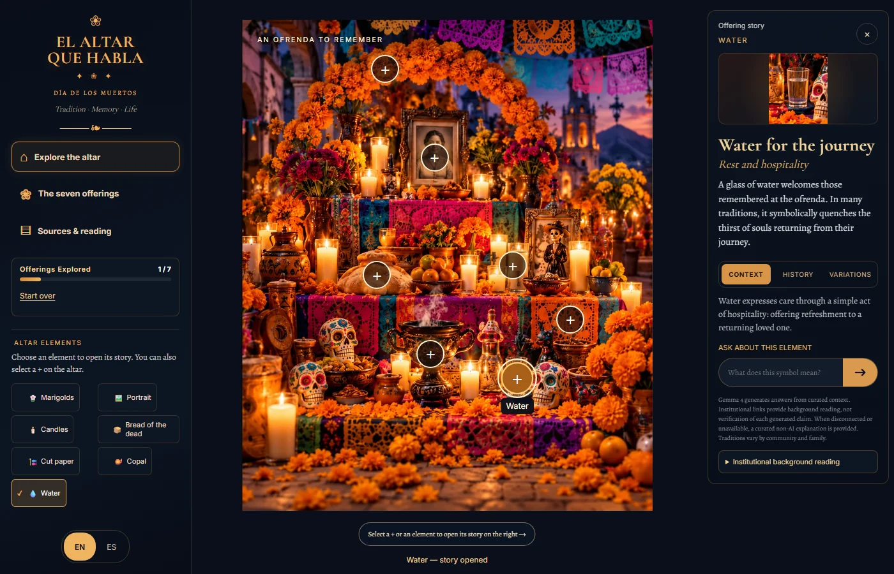
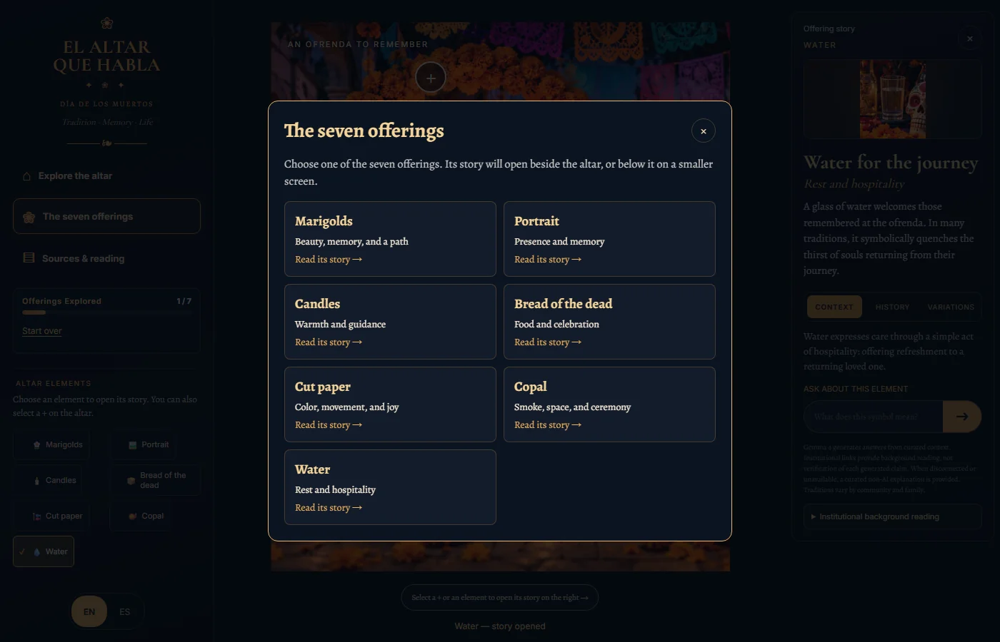

# Clearer exploration flow

Base: merged corrective release `010aefd6287edc1228715cdd7ae7b07c74f4bb9e`.

- Equal side rails center the altar on the page. The desktop story card is under
  300px wide, height-bounded, and closed until a visitor selects an offering.
- Explore visibly closes the story and restores the full altar view without
  erasing progress. The seven offerings button opens a native dialog chooser.
- Every selection opens and focuses the story heading, labels the selected
  hotspot, and announces that its story opened. Guidance explains the connection
  to the right-hand panel on desktop and the story below on smaller screens.
- Start over clears the visited set, completion badge, selection, question and
  pending answer; progress starts at 0/7. Closing a story preserves progress.
- Institutional background reading is a native disclosure to keep the card
  compact while retaining keyboard-accessible references.
- The water description, Context, History and Variations are reviewed bilingual
  fixed copy; matching Gemma context is updated. INPI's existing reference
  documents the association between water and thirst after the souls' journey.
  Other offerings' cultural explanations and the provider integration are unchanged.

## Validation

- `npm test`: 33 unit/endpoint checks pass.
- `npm run build`: passes.
- `npm run test:e2e`: 14 Chromium browser checks pass without snapshot updates.
- 390×844 and 768×1024 touch emulation plus 1400×900 desktop: all seven real
  targets, bilingual panel mapping, image containment, no overlap or horizontal
  overflow, chooser/close/Escape behavior, progress reset and keyboard destinations.
- Explicit geometry checks put the image center within 2px of the page center;
  Explore returns the stage top into view. The new image sizes and tooltip states
  were inspected before accepting the updated visual baselines.
- Existing mock-provider, curated fallback and stale-response checks remain.
  No live provider request or production deployment was performed for this change.

## Screenshots

[Desktop landing](exploration-landing-desktop.webp) ·
[Tablet landing](exploration-landing-tablet.webp) ·
[Mobile story](exploration-story-mobile.webp)
